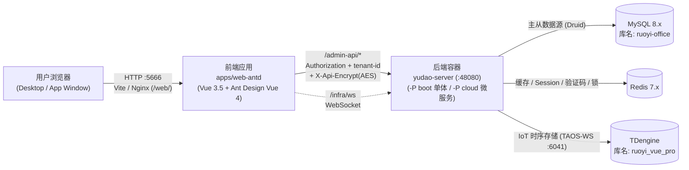

# 01 · 系统总体架构设计（System Architecture）

## 一、系统定位与技术全景

MyERP 是一套前后端一体的数字化企业办公与经营管理平台，在单一仓库内统筹 **后端服务群容器（Java / Spring Boot 3.5）** 与 **PC 管理端（Vue 3 / TypeScript / macOS 桌面应用外壳）**。

---

## 二、核心技术栈与版本基线

以下版本直接取自仓库清单 [yudao-dependencies/pom.xml](../../yudao-dependencies/pom.xml)、根 [pom.xml](../../pom.xml) 与 [pnpm-workspace.yaml](../../ruoyi-office-vben/pnpm-workspace.yaml)：

### 2.1 后端技术栈

| 领域           | 组件与版本                                                                                                         | 说明                                                    |
| :------------- | :----------------------------------------------------------------------------------------------------------------- | :------------------------------------------------------ |
| 语言与构建     | Java 17（本地 JDK 21 兼容运行）、Maven 3.9+                                                                        | 统一 `revision=2026.01-SNAPSHOT`                        |
| 核心框架       | Spring Boot `3.5.9`、Spring Cloud `2025.0.0`、Spring Cloud Alibaba `2023.0.3.3`                                    | 支持 `-P boot` 单体与 `-P cloud` 微服务切换             |
| 持久层与数据源 | MyBatis `3.5.19`、MyBatis-Plus `3.5.15`、MyBatis-Plus-Join `1.5.5`、Dynamic-Datasource `4.5.0`、Druid `1.2.27`     | 多数据源路由（`master` / `slave` / `tdengine`）         |
| 缓存与锁       | Redisson `3.52.0`、Lock4j `2.2.7`                                                                                  | 分布式缓存、分布式锁与验证码缓存                        |
| 流程引擎       | Flowable `7.2.0`                                                                                                   | `history-level: audit`，支撑 BPM 流程审批               |
| 接口文档       | SpringDoc `2.8.14`、Knife4j `4.5.0`                                                                                | 访问入口 `http://127.0.0.1:48080/doc.html`              |
| 扩展能力       | FastExcel `1.3.0`、JustAuth `1.16.7`、JimuReport `2.1.3` / JimuBi `2.3.0`、Netty `4.2.9.Final`、AJ-Captcha `1.4.0` | 导入导出、第三方登录、积木报表/BI、IoT 通信与滑块验证码 |

### 2.2 前端技术栈

| 领域         | 组件与版本                                                                                                                       | 说明                                         |
| :----------- | :------------------------------------------------------------------------------------------------------------------------------- | :------------------------------------------- |
| 运行与包管理 | Node.js `>=20.19.0`（本机 `v22.23.4`）、pnpm `10.28.2`、Turborepo `^2.8.3`                                                       | Monorepo 多包工作区                          |
| 核心框架     | Vue `^3.5.27`、Vue Router `^4.6.4`、Pinia `^3.0.4`、TypeScript `^5.9.3`                                                          | 状态持久化支持加密存储                       |
| 构建与样式   | Vite `^7.3.1`、Tailwind CSS `^3.4.19`、Ant Design Vue `^4.2.6`、Vxe Table `^4.17.46`                                             | 生产构建基础路径 `base: /web/`               |
| 专业生态     | `bpmn-js` `^17.11.1`、`echarts` `^6.0.0`、`grid-layout-plus` `^1.1.1`、`@form-create/antd-designer` `^3.4.0`、`tinymce` `^7.3.0` | 流程建模、图表、桌面 24 栅格排版、表单设计器 |

---

## 三、单体（`-P boot`）与微服务（`-P cloud`）双模架构

根 [pom.xml](../../pom.xml#L59-L80) 通过 Maven Profile 控制子模块打包行为：

| Profile             | `skip.repackage` | 行为说明                                                                                                                                                                                                      | 适用场景                                                  |
| :------------------ | :--------------- | :------------------------------------------------------------------------------------------------------------------------------------------------------------------------------------------------------------ | :-------------------------------------------------------- |
| **`boot`**          | `true`           | 各业务 `*-server` 子模块跳过 `spring-boot-maven-plugin` 二次打包，保持普通 Jar，仅 `yudao-server` 打成可执行 Fat Jar（`yudao-server/target/yudao-server.jar`）；`application.yaml` 中关闭 Nacos 注册/配置发现 | 当前本地研发与一体化单体部署（`./dev.sh build` 默认方式） |
| **`cloud`**（默认） | `false`          | 各 `*-server` 与 `yudao-gateway` 打成独立可执行微服务包，接入 Nacos 服务发现与 OpenFeign RPC 调用                                                                                                             | 后续按域拆分微服务分布式部署                              |

---

## 四、开发环境服务与端口拓扑

| 服务/中间件                  | 本地地址/端口                             | 启动/检查方式       | 关键配置位置                                                                                                                                                       |
| :--------------------------- | :---------------------------------------- | :------------------ | :----------------------------------------------------------------------------------------------------------------------------------------------------------------- |
| 后端主服务（`yudao-server`） | `http://127.0.0.1:48080`                  | `./dev.sh backend`  | [application.yaml](../../yudao-server/src/main/resources/application.yaml)、[application-local.yaml](../../yudao-server/src/main/resources/application-local.yaml) |
| Swagger / Knife4j 文档       | `http://127.0.0.1:48080/doc.html`         | 随后端自动开启      | `springdoc.*` / `knife4j.*`                                                                                                                                        |
| 健康检查（Actuator）         | `http://127.0.0.1:48080/actuator/health`  | `./dev.sh status`   | `management.endpoints.web.base-path: /actuator`                                                                                                                    |
| 前端开发服务器（Vite）       | `http://127.0.0.1:5666`                   | `./dev.sh frontend` | [vite.config.mts](../../ruoyi-office-vben/apps/web-antd/vite.config.mts)、[.env.development](../../ruoyi-office-vben/apps/web-antd/.env.development)               |
| MySQL                        | `127.0.0.1:3306`（容器 `mysql`）          | `./dev.sh status`   | `spring.datasource.dynamic.datasource.master`                                                                                                                      |
| Redis                        | `127.0.0.1:6379`（容器 `myerp-redis`）    | `./dev.sh status`   | `spring.data.redis`                                                                                                                                                |
| TDengine                     | `127.0.0.1:6041`（容器 `myerp-tdengine`） | `./dev.sh status`   | `spring.datasource.dynamic.datasource.tdengine`                                                                                                                    |
