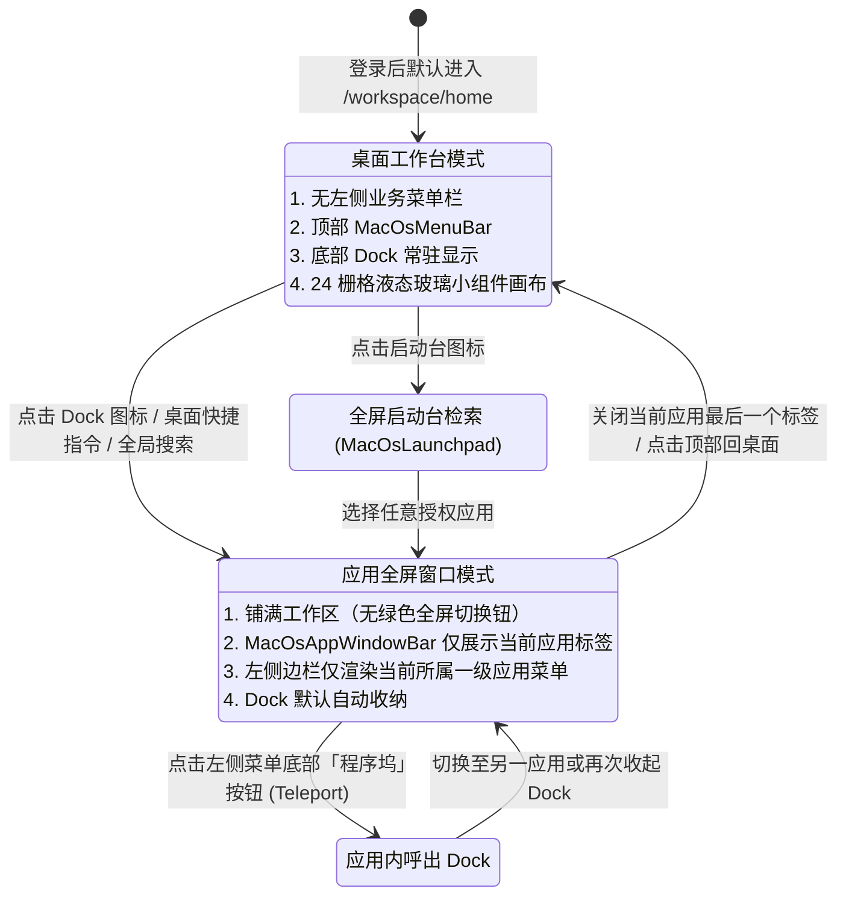

# 03 · 前端与 macOS 桌面外壳设计文档（Frontend & macOS Shell Design）

## 一、前端 Monorepo 分层

前端工程位于 `ruoyi-office-vben/`，采用 pnpm Workspace + Turborepo 组织：

- **主应用（`apps/web-antd/`）**：基于 Ant Design Vue 4 构建，承担全部业务页面、权限路由、API 请求拦截及 macOS 桌面工作台外壳。
- **核心底座包（`packages/@core/`）**：`base/shared`、`base/icons`、`preferences`、`composables`、`ui-kit/*`（表单、布局、菜单、弹窗、标签等无业务耦合的基础组件）。
- **扩展效应包（`packages/effects/`）**：`access`、`common-ui`、`hooks`、`layouts`、`plugins`、`request`。
- **工程化配置（`internal/`）**：`@vben/vite-config`（含打包头 `license.ts`、元数据注入 `inject-metadata.ts` 与控制台信息 `application.ts`）、Tailwind、ESLint、Prettier、Stylelint 与 Commitlint 配置。

---

## 二、认证、路由与请求拦截链路

### 2.1 引导与动态菜单加载

1. 应用启动入口 [bootstrap.ts](../../ruoyi-office-vben/apps/web-antd/src/bootstrap.ts) 初始化组件适配器、表单配置、i18n、Pinia Store、全局权限指令与路由守卫，并加载 `styles/macos-shell.css`。
2. 路由守卫 [guard.ts](../../ruoyi-office-vben/apps/web-antd/src/router/guard.ts) 执行两层拦截：
   - `setupCommonGuard`：记录已加载路由；对 `/workspace/home` 与 `/workspace` 强制标记 `to.meta.hideInTab = true`，避免桌面路由进入应用内多标签队列。
   - `setupAccessGuard`：无 `accessToken` 跳转 `/auth/login`（支持 `redirect` 参数回跳）；首次登录后拉取字典缓存并调用 `authStore.fetchUserInfo()`，随后由 [access.ts](../../ruoyi-office-vben/apps/web-antd/src/router/access.ts) 的 `generateAccess()` 以 `accessMode: 'backend'` 将后端菜单树与 `import.meta.glob('../views/**/*.vue')` 动态映射注册到 Vue Router。

### 2.2 请求管道（[request.ts](../../ruoyi-office-vben/apps/web-antd/src/api/request.ts)）

- **统一请求头**：自动附加 `Authorization: Bearer <token>`、`Accept-Language`、`tenant-id`、`visit-tenant-id`。
- **API 加解密**：当请求头声明 `isEncrypt` 且开启 `VITE_APP_API_ENCRYPT_ENABLE=true` 时，使用 `createApiEncrypt(import.meta.env)` 加密请求体并标记 `X-Api-Encrypt: true`，并在响应拦截器自动解密密文响应。
- **无感续期**：Token 过期时触发 `doRefreshToken()`，刷新失败则按 `loginExpiredMode` 弹窗或注销回登录页。

### 2.3 Vite 构建差异须知

- 开发代理在 [vite.config.mts](../../ruoyi-office-vben/apps/web-antd/vite.config.mts) 中将 `/admin-api` 转发到 `http://localhost:48080/admin-api`。
- 生产构建阶段（`vite build`）配置了 `excludeDirectoriesPlugin()`，会在 Rollup 阶段排除 `src/views/asset/` 与 `src/views/wms/` 目录；开发态（`dev`）不受此排除影响。

---

## 三、macOS 桌面应用外壳架构（`src/layouts/macos/`）

为解决传统后台在 17+ 个大型子系统间菜单层级过深、切换割裂的问题，主布局 [basic.vue](../../ruoyi-office-vben/apps/web-antd/src/layouts/basic.vue) 将 `@vben/layouts` 的 `BasicLayout` 包裹在 macOS 桌面级窗口容器 `.macos-shell` 内，实现「**工作台桌面 + 恒定总宽程序坞 + 独立应用全屏窗口**」的三态交互模型。

### 3.1 核心状态管理（[use-macos-shell.ts](../../ruoyi-office-vben/apps/web-antd/src/layouts/macos/use-macos-shell.ts)）

| 状态 / 能力               | 存储/计算方式                                      | 设计说明                                                                                                                                            |
| :------------------------ | :------------------------------------------------- | :-------------------------------------------------------------------------------------------------------------------------------------------------- |
| `isDesktopMode`           | `route.path === '/workspace/home' \| '/workspace'` | 控制桌面态与业务应用窗口态视图切换                                                                                                                  |
| `isDockVisible`           | `isDesktopMode \|\| dockRevealedInApp`             | 桌面常驻 Dock；进入应用自动隐藏，路由变化与打开启动台时自动归位收起                                                                                 |
| `activeApp` / `tabsOfApp` | 基于一级菜单前缀匹配                               | 实现「按应用隔离窗口标签页」；每个一级应用维护 `lastPathByApp` 记忆，切回应用自动恢复现场                                                           |
| `closeTabInApp`           | 标签关闭策略                                       | 关闭非最后标签时自动切换相邻标签；关闭所属应用的最后一个标签页时调用 `closeApp` 自动退回桌面                                                        |
| 本地持久化                | `localStorage`                                     | `macos-shell:wallpaper`（默认 `sequoia`）、`macos-shell:pinned-apps`（默认固定 `/erp`、`/wms`、`/crm`、`/oa`、`/bpm`、`/hrm`、`/asset`、`/system`） |

### 3.2 偏好强制锁定（`preferences.ts` 与 `basic.vue`）

`BasicLayout` 外壳配置在 [preferences.ts](../../ruoyi-office-vben/apps/web-antd/src/preferences.ts) 与 `basic.vue` 启动校正逻辑中强制维持：

- `app.layout = 'mixed-nav'`、`navigation.split = true`：确保左侧菜单栏仅渲染当前活跃一级应用下的子菜单。
- `app.defaultHomePath = '/workspace/home'`：登录默认落点为工作台桌面。
- `header.enable = false`、`header.height = 0`、`tabbar.enable = true`、`tabbar.height = 0`：隐藏原生 Vben 顶栏与标签栏外观，仅保留 `BasicLayout` 内部 `tabbar` 节点维持路由 `keep-alive` 缓存，视觉控制全部交由 `MacOsMenuBar` 与 `MacOsAppWindowBar`。

### 3.3 外壳核心组件清单

| 组件           | 文件路径                                                                                                                                                                      | 核心职责                                                                                                                                                                                  |
| :------------- | :---------------------------------------------------------------------------------------------------------------------------------------------------------------------------- | :---------------------------------------------------------------------------------------------------------------------------------------------------------------------------------------- |
| 顶部菜单栏     | [menu-bar.vue](../../ruoyi-office-vben/apps/web-antd/src/layouts/macos/menu-bar.vue)                                                                                          | 当前应用名、回桌面入口、壁纸切换（Sequoia/Tahoe/晴岚/极光）、全局搜索、通知中心、偏好设置、用户菜单（精简仅保留个人中心/锁屏/退出）与实时中文时钟                                         |
| 应用窗口栏     | [app-window-bar.vue](../../ruoyi-office-vben/apps/web-antd/src/layouts/macos/app-window-bar.vue)                                                                              | 侧边栏折叠开关、当前应用 Squircle 徽标、当前应用作用域内的标签页切换与关闭、刷新与面包屑                                                                                                  |
| 恒定总宽程序坞 | [dock-bar.vue](../../ruoyi-office-vben/apps/web-antd/src/layouts/macos/dock-bar.vue)                                                                                          | 通过单条 `requestAnimationFrame` 循环同时驱动 `hoverMix` 与光滑光标位置；主图标从 `48px` 平滑放大至 `64px` 同时约束整条扩展总量 `MAX_HOVER_EXPAND_SUM = 36`，实现鼠标滑过时两侧边缘零抖动 |
| 侧栏程序坞按钮 | [basic.vue](../../ruoyi-office-vben/apps/web-antd/src/layouts/basic.vue#L348-L409)                                                                                            | 应用窗口态下通过 `<Teleport>` 挂载到 `aside` 底部，点击调用 `toggleDock()`，折叠态自适应图标展示                                                                                          |
| 全屏启动台     | [launchpad-modal.vue](../../ruoyi-office-vben/apps/web-antd/src/layouts/macos/launchpad-modal.vue)                                                                            | 展示全部已授权一级应用，支持关键词搜索与右键/按钮固定到 Dock                                                                                                                              |
| 应用图标系统   | [mac-app-icon.vue](../../ruoyi-office-vben/apps/web-antd/src/layouts/macos/mac-app-icon.vue) + [config.ts](../../ruoyi-office-vben/apps/web-antd/src/layouts/macos/config.ts) | 为 17 个一级模块提供专属 macOS Squircle 渐变与 SVG/Lucide 图标；未命中映射的路径使用确定性哈希分配渐变色                                                                                  |

---

## 四、工作台桌面与小组件体系（`src/views/dashboard/home/`）

- **入口分流（[index.vue](../../ruoyi-office-vben/apps/web-antd/src/views/dashboard/home/index.vue)）**：默认渲染 `MacOsDesktopWorkspace`；当 URL 携带 `?preview=<pageId>` 时兼容回退至原有 `LayoutRenderer` 进行首页管理/设计器预览。
- **24 栅格与组件注册（[widget-registry.ts](../../ruoyi-office-vben/apps/web-antd/src/views/dashboard/home/desktop/widget-registry.ts)）**：
  - 支持自由拖拽、缩放与添加/重置组件（`MAC_DESKTOP_WIDGETS`）：
    1. `mac_clock_greeting`：时钟、农历、问候与待办摘要
    2. `mac_erp_overview`：ERP 经营速览（支持一键进入 ERP）
    3. `mac_wms_overview`：WMS 仓储动态
    4. `mac_todo_tasks`：BPM 流程待办与我发起的单据
    5. `mac_notice_board`：系统通知公告（支持桌面直接弹窗阅读）
    6. `mac_calendar_schedule`：月历与日程提醒
    7. `mac_quick_shortcuts`：常用业务快捷入口矩阵
  - 小组件优先按后端实际授权数据请求，并在无权限或接口不可用时做降级保护，不阻断桌面整体渲染。
