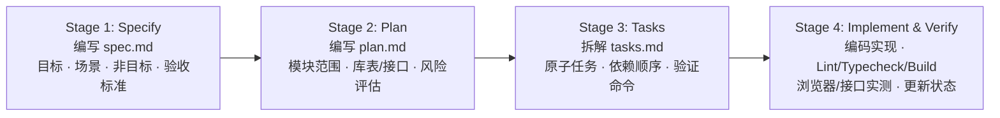

# 04 · Spec-Driven Development（SDD）工作流与规范指南

本仓库采用轻量化、面向工程落地的 **Spec-Driven Development（规范驱动开发）**，核心目标是：**先对齐规格与验收边界，再设计技术方案与任务拆解，最后编码实现并以真实证据验收**。

---

## 一、四阶段标准流程



### Stage 1 · Specify（规格定义 -> `spec.md`）

- 聚焦 **“做什么（What）”与“为什么（Why）”**，不提前陷入具体实现细节。
- 必须明确 **Out of Scope（明确不做）**，避免开发过程中范围蔓延。
- 每条核心能力须附带可验证的 **验收标准（Acceptance Criteria / Given-When-Then）**。

### Stage 2 · Plan（技术方案 -> `plan.md`）

- 对照 [00-constitution.md](00-constitution.md) 检查宪章约束（多租户 `tenant_id`、权限注解、`X-Api-Encrypt`、macOS 外壳交互锁、`-P boot` 打包兼容性等）。
- 明确影响的后端模块（`*-api` / `*-server` / `script/sql/`）与前端范围（`apps/web-antd` / `packages/*`）。
- 列出数据模型变更、REST 接口契约及前端路由/状态影响，评估回滚与兼容策略。

### Stage 3 · Tasks（任务拆解 -> `tasks.md`）

- 将方案拆分为 **可独立验证的小步任务**（通常按「数据库与脚本 -> 后端 API/Service/Controller -> 前端 API/Store/UI -> 测试与构建验证」排序）。
- 每个任务标明目标文件与完成判定（Done Definition）。

### Stage 4 · Implement & Verify（实现与实证验收）

- 按 `tasks.md` 逐步实施，完成后按 [AGENTS.md](../../AGENTS.md) 执行对应层级的真实检查：
  - **后端**：`mvn -B -ntp -P boot -Dmaven.test.skip=true clean package`、目标模块单测、接口 Swagger/HTTP 实测、`./dev.sh status`。
  - **前端**：修改文件的 `./node_modules/.bin/eslint`、`./node_modules/.bin/prettier --check`、`pnpm --filter @vben/web-antd typecheck`（确认修改文件 0 新增错误）、生产构建 `pnpm --filter @vben/web-antd build`，涉及界面交互的须在真实浏览器中验证。
- 完成后将 `spec.md` 顶部状态更新为 `Implemented`，若涉及架构或全局交互调整，同步回写 `docs/sdd/01~03`。

---

## 二、目录与命名约定

- 每次功能迭代在 `docs/sdd/specs/` 下新建目录：
  ```text
  docs/sdd/specs/<NNN>-<kebab-case-name>/
  ├── spec.md      # 由 templates/spec-template.md 复制生成
  ├── plan.md      # 由 templates/plan-template.md 复制生成
  └── tasks.md     # 由 templates/tasks-template.md 复制生成
  ```
- 编号 `<NNN>` 从 `001` 顺序递增（如 `001-macos-desktop-shell`、`002-erp-purchase-approval`）。
- 模板文件位于 [docs/sdd/templates/](templates/)。

---

## 三、交付前检查清单

- [ ] 是否已在动手前对照 [00-constitution.md](00-constitution.md) 验证不变量？
- [ ] 多租户新表是否包含 `tenant_id` 或已加入 `yudao.tenant.ignore-tables`？
- [ ] 是否无真实/高风险示例密钥字符串入库？
- [ ] 修改 `packages/@core/base/shared/` 后是否执行了 `@vben-core/shared build`？
- [ ] 汇报给用户的测试、命令结果与文件路径是否全部经过真实执行确认？
